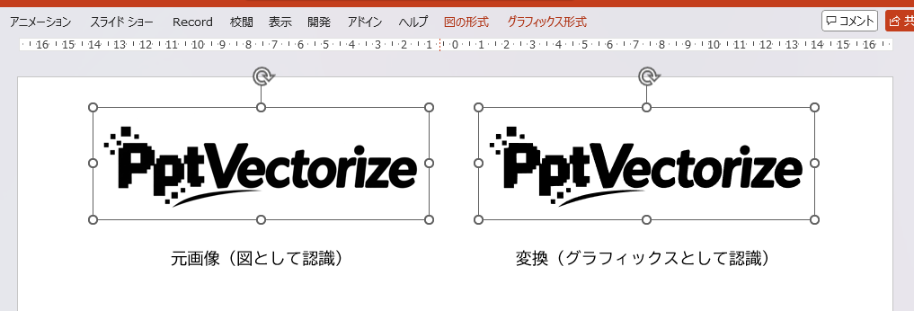
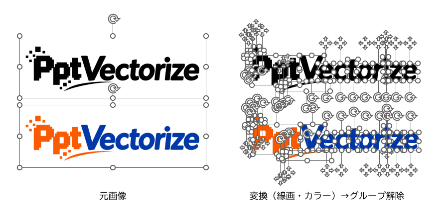
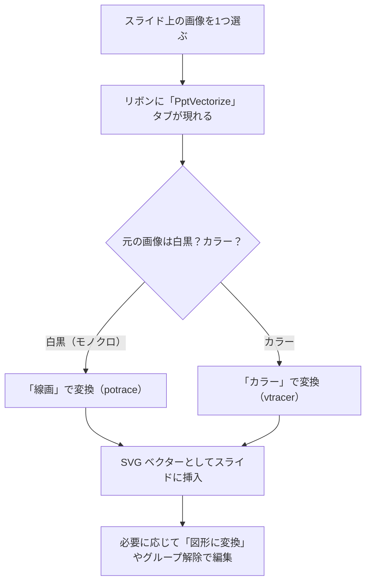
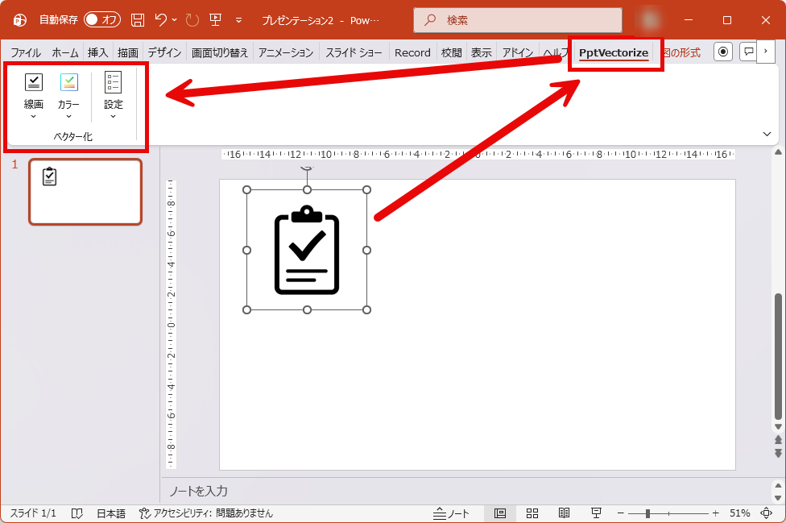
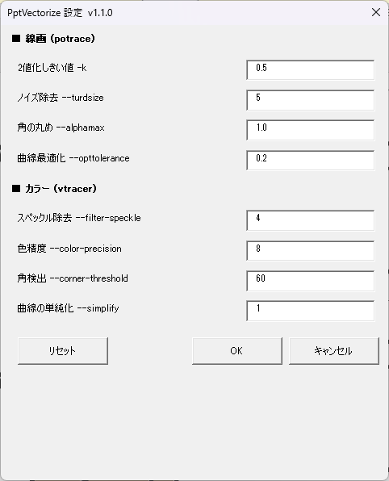
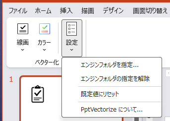
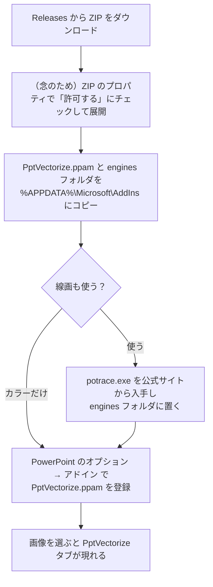
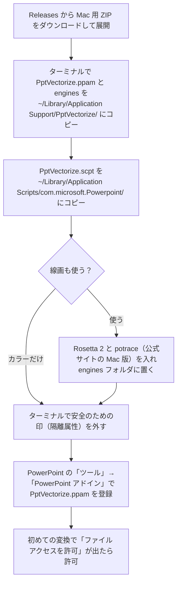

# PptVectorize-releases
PptVectorize — PowerPoint の画像を SVG ベクターに変換するアドイン（公開配布用リポジトリ）

  

PowerPoint 上の画像（PNG・JPEG など）を、**リボンのボタン1つで SVG ベクターに変換してスライドに挿入する**
Windows・Mac 用アドイン **PptVectorize** の公開配布リポジトリです。
配布 ZIP は本リポジトリの [**Releases**](../../releases) ページからダウンロードできます。

> **PptVectorize は無償のプロプライエタリ・ソフトウェアです（オープンソースではありません）。**
> ご利用には [利用規約](./利用規約.txt) への同意が必要です。インストールまたは利用した時点で、同意したものとみなします。

## 最新版のダウンロード

[➡ 最新リリースを開く](../../releases/latest)

お使いのパソコンに合わせて、次のどちらかをダウンロードしてください。

| パソコン | ダウンロードするファイル（例） |
|----------|------------------------------|
| Windows | `PptVectorize_v<版>.zip`（例: `PptVectorize_v1.2.0.zip`） |
| Mac | `PptVectorize_v<版>_mac.zip`（例: `PptVectorize_v1.2.0_mac.zip`） |

## 主な特徴

- 🔒 **完全オフライン** — 画像はこのパソコンの中だけで変換し、外部へ一切送信しません。
  社外秘・研究・医療などの画像にも使えます。
- 🖱 **PowerPoint の中で完結** — 画像を選んでリボンのボタンを押すだけ。別のツールとの往復は不要です。
- 🎨 **線画とカラーの2方式**
  - **線画**: 白黒（モノクロ）の画像向き。白黒のまま変換します（エンジン: potrace）
  - **カラー**: カラー画像向き。色を保ったまま変換します（エンジン: vtracer）
- ✏️ **変換後に編集できる** — 挿入された SVG は、PowerPoint の「図形に変換」やグループ解除で、
  文字や部品ごとに色を変えたり動かしたりできます。
- ⚙️ **調整もできる** — 既定値のまま即変換するほか、「調整して変換…」でパラメータを変えてから変換できます。

## 変換の例

  

左が元の画像（PowerPoint では「図」）、右が変換後（「グラフィックス」）です。見た目はほぼそのままに、ベクターになります。

  

変換後にグループを解除すると、文字やドットが一つ一つ別の図形に分かれ、個別に色を変えたり動かしたりできます
（上段: 線画、下段: カラー）。

## 使い方の流れ

## スクリーンショット

  

画像を1つ選ぶと **PptVectorize タブ** が現れます。「線画」「カラー」で即変換、各ボタンの ▼ から「調整して変換…」を選べます。

  
  

左: 設定画面（線画・カラーそれぞれ4項目）。右: 設定 ▼ のメニュー。

## 動作環境

**Windows**
- Windows 11
- PowerPoint 2019 以降 または Microsoft 365 の**デスクトップ版**（Web 版は非対応）
  - SVG の挿入に対応している版が必要です。買い切り版の PowerPoint 2016 は SVG の挿入に対応していないため、動作対象外です。

**Mac**（v1.2.0 から）
- Apple シリコン搭載の Mac（動作確認: M1 Mac mini / macOS Golden Gate 27.2.1。Intel 搭載の Mac は未確認）
- PowerPoint for Mac（Microsoft 365）の**デスクトップ版**

## 導入方法（Windows）

詳しい手順は、ZIP に同梱の **`インストール手順_Windows.pdf`**（本リポジトリの [インストール手順_Windows.pdf](./インストール手順_Windows.pdf) と同じもの）をご覧ください。
おおまかな流れは次のとおりです。

### ZIP の中身

| ファイル | 内容 |
|----------|------|
| `PptVectorize.ppam` | アドイン本体 |
| `engines\vtracer.exe` | カラー変換エンジン（MIT ライセンス・同梱） |
| `インストール手順_Windows.pdf` | 導入・使い方・困ったときの手順書 |
| `LICENSE.txt` | 本体のライセンス |
| `利用規約.txt` | 利用条件の全文 |
| `THIRD_PARTY_LICENSES.txt` | 第三者ソフトウェアのライセンス表示 |

## 導入方法（Mac）

詳しい手順は、Mac 用 ZIP に同梱の **`インストール手順_Mac.pdf`**（本リポジトリの [インストール手順_Mac.pdf](./インストール手順_Mac.pdf) と同じもの）をご覧ください。
ファイルのコピーなどは、手順書のコマンドをターミナルに貼り付けて行います。おおまかな流れは次のとおりです。

> `~/Library` は、ホームフォルダの中の「ライブラリ」です（ふだんは隠しフォルダ。Finder で `⌘ + ⇧ + .` を押すと表示されます）。
> 「Macintosh HD」直下の「ライブラリ」ではありません。

### ZIP の中身（Mac）

| ファイル | 内容 |
|----------|------|
| `PptVectorize.ppam` | アドイン本体（Windows 版と同じファイル） |
| `engines/vtracer` | カラー変換エンジン（Apple シリコン用。MIT ライセンス・同梱） |
| `PptVectorize.scpt` | Mac で変換エンジンを動かすための AppleScript |
| `インストール手順_Mac.pdf` | 導入・使い方・困ったときの手順書 |
| `LICENSE.txt` | 本体のライセンス |
| `利用規約.txt` | 利用条件の全文 |
| `THIRD_PARTY_LICENSES.txt` | 第三者ソフトウェアのライセンス表示 |

## 線画エンジン potrace について

線画変換に使う **potrace は同梱していません**（GPLv2 ライセンスのため）。
線画も使う場合は、公式サイト <https://potrace.sourceforge.net> から入手してください。カラー変換だけなら不要です。

- **Windows**: Windows 版を入手し、`potrace.exe` を `engines` フォルダに置きます。
- **Mac**: Mac 版（`potrace-1.16.mac-x86_64.tar.gz`。Intel 用）を入手し、`potrace` を `engines` フォルダに置きます。
  Apple シリコンの Mac では Rosetta 2 を通して動きます（手順は `インストール手順_Mac.pdf`）。

## お問い合わせ

ご質問・不具合のご連絡は、ウェブサイトのお問い合わせからお願いします。

🌐 **<https://www.ogulinks.com/>**

お問い合わせの際は、リボンの **設定 ▼ →「PptVectorize について…」** に表示される内容（版・使用中のエンジンの場所など）をお知らせください。

## ソースコード

ソースコードは別の非公開リポジトリで管理しており、本リポジトリでは配布物のみを公開しています。

## ライセンス

- **PptVectorize 本体**: 無償のプロプライエタリ・ソフトウェアです。業務での利用は可能ですが、
  販売・再配布・改変・変換作業の有償サービス化は禁止しています。
  詳しくは [LICENSE.txt](./LICENSE.txt) と [利用規約.txt](./利用規約.txt) をご覧ください。
- **vtracer**（同梱）: MIT License。[THIRD_PARTY_LICENSES.txt](./THIRD_PARTY_LICENSES.txt) を参照。
- **potrace**（同梱せず、利用者が公式サイトから入手）: GPLv2。

Copyright (c) 2026 小倉淳（OguLinks / Ogu Tech Lab）. All rights reserved.
